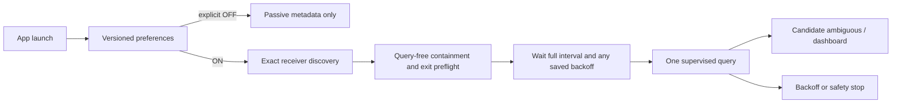

# Asset-driven dashboard and normal HyperX startup

This change implements the owner's dashboard briefing plus its later automatic-startup addendum. The owner's final cadence instruction is **120 seconds by default**, overriding the addendum's proposed 300 seconds. Existing valid 60/120/300 selections remain unchanged.

Base: main `b062f40`, including Stage K through PR #5 and the owner's new transparent PNG uploads. Branch: `feature/asset-driven-dashboard`. Historical F/H/I/K default-off and session-consent statements describe their stages, not the newly authorized normal startup path. Native protocol and containment guarantees remain in force.

## Requirements conflict / startup path

| Gate | Historical production path | New production path |
|---|---|---|
| Default automatic preference | OFF / 120 | ON / 120 when unset or invalid |
| Settings visited | Session checkbox event required | Never required |
| Per-session warning/acknowledgement | Required before normal monitor | Removed from normal startup/settings |
| Explicit saved OFF | Retained | Retained across restart |
| Valid saved interval | 60/120/300 | Preserved |
| Receiver metadata | Exact target required | Unchanged |
| Helper preflight | User-triggered, query-free | Automatically run once after eligibility; query-free |
| First battery request | After manually enabled readiness | Full configured interval after verified readiness |
| Backoff/suspension | Session-only 2/5/15 delays, fourth failure pause | Same delays/pause, persisted across restart |
| Unsafe exit/cleanup | Transport session latch | Transport latch plus durable safety marker; restart is not recovery |

`HyperXStartupCoordinator` is the same UI-independent orchestrator called by `TrayApplicationContext` and the fake-backed startup/restart tests. `HyperXBatteryProvider.ConfigureMonitoring` enables the normal provider after verified preflight, independently of the retained legacy session API. The old experimental checkbox and warning handler are removed from production settings; manual controls remain, guarded by actual readiness. Opening/hiding/Refresh still never requests a battery report. The existing five-second metadata wakeup can add up to one wakeup plus discovery time to a due check; no battery requests occur every five seconds or catch up in a burst.

Settings ON/OFF reflects `UserMonitoringEnabled`, while the dashboard separately reports readiness, pause or safety stop. ON from OFF runs preflight and waits the full interval. A concurrent OFF cannot be overwritten by late preflight completion. Explicit Resume is required for an ordinary saved suspension; it cannot reset a safety latch.

## Preferences, migration and crash safety

The existing LocalApplicationData `PeripheralBatteryCompanion/hyperx-monitoring.json` becomes version 2: `UserMonitoringEnabled`, `IntervalSeconds`, `SafetyLatched`, `Suspended`, `Failures`, `RetryNotBefore`. Legacy `Enabled` maps to user choice. Legacy experimental/acknowledgement fields are ignored. Existing code only wrote its old file on UI preference edits, but its schema cannot prove intent perfectly: any existing `Enabled: false` is conservatively preserved as OFF. A missing `Enabled` field is not treated as a deliberate OFF. This may retain OFF for a legacy file created elsewhere with defaults; the owner can explicitly select ON once. Future files reliably distinguish an absent file from explicitly false.

Missing, malformed, oversized or invalid preference values default ON / 120; a valid boolean OFF is preserved even when its interval is invalid. A separate `hyperx-monitoring.json.safety-stop` marker overrides those defaults. Read/access failures fail closed. No device path, report bytes, identifier or acknowledgement is persisted. Writes are serialized and preferences replaced via a temporary file. Unchanged snapshots do not cause five-second disk writes.

Before preflight or native transport submission, a durable safety stop must be successfully written. The native wrapper clears it only after completion-safe cleanup **and** a still-verified underlying transport. A process crash, invalid IPC, forced/unknown exit, retained startup or missing cleanup leaves it set. A normally exited negative result first persists a conservative 15-minute floor before the scheduler records its exact 2/5/15 delay, closing the crash window between transport return and schedule persistence. Fourth failure suspension is saved. Application restart and checkbox toggles never clear a stop. Marker-write failure refuses before launching the operation.

**Recovery is owner-reviewed:** there is deliberately no button that erases an uncertain-exit stop. Exit, review diagnostics and process/driver state, and establish cleanup before any deliberate profile repair. Do not delete the marker simply to make querying work. Normal idle restart needs no action; shutdown during a native exchange can conservatively require review. The existing OS limitation remains: a defective driver can delay process termination indefinitely. No finite kernel-cleanup guarantee is claimed.

The wrapper reuses `HyperXHelperTransport`; it contains no HID P/Invoke or packet construction. The helper/native assemblies, fixed 62-byte 66/89 exchange, three-second I/O deadline, exact metadata, NGENUITY inspection and standalone POC guards are unchanged. G915 reader/cadence, G305 unsupported state, tray icon/tooltip and single-instance startup remain unchanged.

## Verified assets and packaging

Canonical files are byte-identical copies; original owner files/history are retained:

| Embedded/canonical image | Owner source | Size | Transparent / partial / opaque alpha pixels | Nonzero-alpha bounds |
|---|---|---|---|---|
| `assets/devices/g915.png` | `RGB Lightspeed Gaming Keyboard Cutout.png` | 1672×941 | 736686 / 836056 / 610 | (0,22)–(1672,932) |
| `assets/devices/g305.png` | `Matte Black Gaming Mouse with Blue Glow (1).png` | 720×448 | 202033 / 120067 / 460 | (139,19)–(580,429) |
| `assets/devices/hyperx-cloud-iii.png` | `HyperX-Style Black and Red Gaming Headset (1).png` | 720×448 | 217841 / 103670 / 1049 | (145,19)–(574,429) |

All three decode as RGBA. Dark/light compositing was visually inspected: true cutouts, no checkerboard backdrop. The older mouse/headset files without `(1)` are RGB with baked checkerboards and are **not used**. No masking, image generation or destructive correction was applied. `scripts/Verify-DashboardAssets.py` verifies original-byte equality, alpha and decoding and produces `artifacts/device-alpha-validation.png`; Pillow is an optional development audit dependency, not an application dependency. This preview is an asset diagnostic, not a Windows screenshot.

The real reference is `assets/references/Neon Gaming Device Battery Dashboard-1.png`, copied without alteration to `assets/references/dashboard-concept.png`. Both remain development-only. Only the three canonical product images are embedded under `Devices.g915.png`, `Devices.g305.png`, `Devices.hyperx-cloud-iii.png`. Debug, self-contained and single-file publish use manifest resources, independent of working directory, source tree or loose asset files. No runtime image download or new NuGet dependency is introduced.

## Geometry and rendering

`DashboardLayout` is the geometry source of truth. At 96 DPI, the borderless window's intended **outer and client sizes both equal 520×570**; there is no duplicate Windows caption. Contract coordinates:

- Header: (16,16), 488×64; title/subtitle, app glyph, gear and hide-only close.
- Cards: (16,90), (16,232), (16,374), each 488×132; ten-pixel gaps.
- Image viewport within each card: (12,10), 180×112. Text region: (204,10), 272×112.
- Footer: (16,516), 488×44; two equal-width actions with a 16-pixel gap; bottom ten pixels.

Product cards cache decoded bitmaps/alpha bounds once, then CONTAIN the full nonzero-alpha silhouette with high-quality interpolation. Native labels/bars show runtime data; sample 38/50 values exist only in tests/reference. Cyan/steel/crimson gradients and localized image-side glows are painted in C#, fade before the text region, and adapt to light/high-contrast themes. GDI objects and images are disposed. No outline-device glyph substitutes for product art. Compact metadata retains full timestamps/uncertainty via tooltips and Advanced.

Advanced settings uses one separate owned, scrollable window containing the same controls/state; both dashboard buttons and the tray entry reach it. It does not enlarge the dashboard. Long G915 errors move to that window with a concise main-card summary and full tooltip, preserving the full diagnostic text. Closing Settings restores dashboard focus; closing/dismissing the dashboard hides both without stopping monitoring. Windows message-thread affinity and owned settings focus are preserved.

Normal 100% geometry is fixed, rather than grown from content. Larger accessibility font metrics expand row/card/header/footer height explicitly and enable working-area scrolling rather than clipping or shrinking text; the nominal 520×570 contract applies to standard 100% metrics. At larger DPI the contract scales proportionally; working-area caps allow vertical scrolling when the screen is physically smaller. No horizontal scrolling is intended. **Native measured geometry and screenshot fidelity are NOT VERIFIED in Linux.** The wider original reference cannot be copied pixel-for-pixel into 520 pixels. Native text metrics, focus, high-DPI sharpness and image/glow comparison remain owner acceptance items, not claims based on arithmetic tests.

## Verification

Baseline: main's recorded 333 portable passes / 20 Windows-specific cases compiled. Before the startup fix, the new clean-start regression failed (`Enabled` expected true, actual false) using the previous startup sequence with fakes. The same named regression now exercises the actual new coordinator and passes without a settings object or acknowledgement.

Current Release solution compilation: PASS, zero warnings/errors. Portable suite: **368 passed, 0 failed, 0 skipped** (27 startup/persistence/coordinator cases and eight layout/contain cases added). **27 Windows-specific cases compile, not run on Linux**, including embedded image decode/geometry/settings isolation and live 0/1/20/38/50/100 bar rendering. Existing Windows assertions now follow the new 520-pixel footprint, separate diagnostic window and removed obsolete consent control; unrelated safety assertions remain. Legacy session API tests remain for historical callers, not the production startup policy.

No physical query, native Windows UI execution, sustained coexistence, screenshot capture, merge or branch deletion was performed. The optional asset audit passed. Build and package the committed tree as Debug win-x64 with the helper and static package gate before distribution. Artifacts are ignored build outputs.

## Owner-owned Windows validation

Launching this application now enables scheduled hardware queries when eligible. **Only the owner should launch it after reviewing and deciding to authorize physical monitoring.** Build/test commands below use fakes and do not launch it.

1. From the checkout, run `powershell -NoProfile -ExecutionPolicy Bypass -File .\test.ps1 -Release -CopySummary` and share the actual clipboard summary. Run the Windows-only layout/asset/process tests before relying on the dashboard. Keep the complete published folder together, including `hyperx-helper`.
2. Exit via the tray first. Back up the existing `hyperx-monitoring.json` and theme file. Inspect any safety-stop marker and JSON safety latch; **do not remove a safety stop for clean-profile testing**. Use a separate reviewed test profile or resolve the stop only after proving cleanup. An unset preference profile should show ON / 120; old deliberate OFF must remain OFF. Existing valid intervals must survive.
3. After approving hardware monitoring, launch without opening Settings. Verify metadata/preflight and the full 120-second (or saved interval) wait, no immediate query, and no intervention required. Restart normally while idle and repeat without touching Settings. Compare percentages with NGENUITY only as a sanity check, never ownership/freshness proof. Check helper exit/audio continuity; stop on disruption or unexplained lifetime.
4. Select OFF, exit and restart: no helper preflight or battery query. Select ON: verify query-free preflight and full interval wait, not an immediate request. Review Cancel/recoverable Resume; test uncertain exits only with fakes. Idle removal must mark old data Stale; reconnect preserves full interval/backoff and never restores an old value as current.
5. On the AOC display at 100% DPI, capture the **real popup** and compare to `assets/references/dashboard-concept.png`: overall 520×570, three complete cards, recognizable full silhouettes, glows behind art only, legible live text and visible footer, no scrolling. Repeat at 125/150/200%, text scaling and smaller/multiple-monitor working areas; record any geometry adaptation rather than shrinking text silently.
6. Open/hide repeatedly; inspect image sharpness, GDI handles, memory, keyboard Tab/Enter/Space/Escape, settings focus/dropdowns, dark/light/system/high contrast, header Close, tray left/double/right click, native tooltip, Refresh and Exit cleanup. Test the published ZIP outside the checkout and with a different current directory. Single-instance guard and G915 monitoring must remain intact.

Full Windows/hardware validation remains pending until the owner supplies results. No Linux mock or layout test is presented as native visual or device proof.
